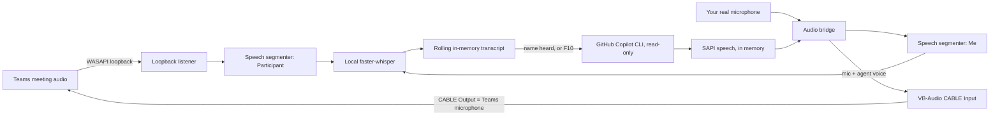

# Meeting mode

Meeting mode lets Harbor Voice join a Microsoft Teams meeting from your own seat. It listens
to the conversation, and when someone addresses it by name ("Scout, …") it answers out loud
into the meeting.

It's the local first phase of a meeting agent. A later phase will add a separate
"Scout (AI)" participant that joins through Azure Communication Services.

## How it works

* **Hearing the meeting:** WASAPI loopback captures whatever Teams plays on your speaker or
  headset. Local faster-whisper transcribes it.
* **Speaking into the meeting:** speech is synthesised in memory and written to the
  VB-Audio virtual cable. Teams uses that cable as its microphone. Your real microphone is
  mixed into the same cable, so you can still talk normally.
* **Context:** the agent keeps a rolling transcript in memory, covering at most the last
  15 minutes. It is discarded when meeting mode stops and is never written to disk.

## One-time setup

1. Install [VB-Audio Virtual Cable](https://vb-audio.com/Cable/). The `CABLE Input` and
   `CABLE Output` devices must exist.
2. In Teams, go to **Settings → Devices** and set:
   * **Microphone:** `CABLE Output (VB-Audio Virtual Cable)`
   * **Speaker:** your normal headset or speakers
   * **Noise suppression:** *Low* or *Off*, so Teams doesn't filter out the synthetic voice.
3. If Teams plays to a device other than your Windows default output, set
   `meeting_loopback_device` to part of that device's name, for example `"Q9-1"` or
   `"Headset"`.

> If Harbor Voice isn't running, your voice won't reach Teams because the cable is silent.
> Switch the Teams microphone back to your real microphone when you aren't using meeting
> mode.

## Using it

| Action | How |
|---|---|
| Start or stop | Tray menu → **Start meeting mode** / **Stop meeting mode** |
| Participant asks the agent | They say "Scout, …" |
| You ask the agent to answer aloud | Say "Scout, …" yourself, or press **F10** to answer the latest question |
| Ask privately (only you hear it) | Hold **F9** as usual. Private turns include the meeting transcript as context |
| Make it stop talking | "Scout, stop", "Scout, that's enough", hold F9, or talk over it for about a second |

When meeting mode starts, the agent introduces itself as an AI assistant so everyone knows
it's listening.

## Settings

Edit these in `%LOCALAPPDATA%\HarborVoice\HarborVoice\settings.json`.

| Setting | Default | Purpose |
|---|---|---|
| `meeting_agent_name` | `"Scout"` | Name used in the introduction and in answers |
| `meeting_owner_name` | `"my user"` | Whose assistant it is, for example `"Russell"` |
| `meeting_wake_words` | `["scout"]` | Whole words that address the agent |
| `meeting_answer_key` | `"f10"` | Shortcut that answers the latest question aloud |
| `meeting_announce` | `true` | Introduces itself when meeting mode starts |
| `meeting_barge_in` | `true` | Stops talking when a participant talks over it |
| `meeting_respond_to_participants` | `true` | When `false`, only you can trigger spoken answers |
| `meeting_loopback_device` | `null` | Speaker device Teams uses (default: Windows default output) |
| `meeting_output_device` | `"CABLE Input"` | Virtual cable the agent speaks into |
| `meeting_mic_passthrough` | `true` | Mixes your real microphone into the cable |
| `meeting_voice` | `null` | SAPI voice name fragment, for example `"Hazel"` |

## Guardrails

* The agent announces itself and only answers when it's named, or when you press F10.
* Meeting answers are **message-only**. File writes, app or URL launches, and clipboard
  actions are refused, and the agent says it can't take actions in a meeting.
* The transcript is treated as untrusted input. The prompt tells the model not to follow
  instructions in it, not to invent figures or commitments, and to defer to you when it's
  unsure.
* Copilot CLI tools stay read-only and limited to the selected workspace folder.
* No audio or transcript is persisted. Logs record only event kinds, never content.
* You are responsible for telling attendees an AI assistant is present and for following
  your organisation's and the meeting's recording and AI policies.

## Limitations

* Speaker attribution is only "Participant" or "Me". Loopback mixes all remote voices.
* Windows SAPI voices sound robotic. Neural voices are planned for the Azure phase.
* Latency is roughly 1–2 seconds for transcription plus 2–4 seconds for reasoning.
* Answers can only draw on the meeting transcript, the model's knowledge, and read-only
  files in the selected workspace. Microsoft 365, MSX, or vault lookups need Copilot CLI
  tools that are disabled by default.
