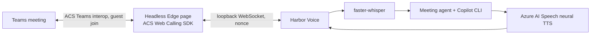
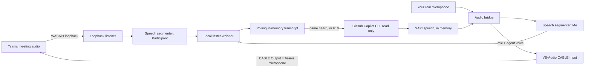

# Meeting mode

Harbor Voice can take part in Microsoft Teams meetings in two ways:

| | **Meeting mode (local)** | **Send Scout to a meeting (Azure)** |
|---|---|---|
| Who is in the meeting | You. Scout speaks through your microphone | Scout joins as its own guest, **"Scout (AI)"** |
| Setup | VB-Audio Virtual Cable | Azure Communication Services + Azure AI Speech |
| Voice | Windows SAPI, or neural if Speech is configured | Azure neural voice (`en-GB-SoniaNeural`) |
| Needs your PC in the call | Yes | No, only Harbor Voice running |
| Speaker attribution | Participant / Me | Participant |

Both modes share the same agent: a rolling in-memory transcript, the "Scout, …" trigger,
the read-only Copilot reasoning session, and the same guardrails.

## Send Scout to a meeting (Azure participant)



1. Tray menu → **Send Scout to a meeting…**, then paste the Teams join link. A link on the
   clipboard is filled in for you.
2. Harbor Voice starts an isolated, throwaway headless Edge profile on `localhost`. It issues
   a short-lived ACS VoIP token using your Azure CLI sign-in and joins the meeting as
   **Scout (AI)**.
3. **Admit Scout (AI) from the lobby.** It introduces itself, then answers whenever it hears
   "Scout, …". Saying "Scout" on its own gets a "Yes?" and the next sentence is treated as the
   question.
4. Tray → **Remove Scout from the meeting**, or remove it from the participant list in
   Teams. Either way the browser profile and transcript are discarded.

### Azure resources

Created in subscription `ME-MngEnvMCAP560477-rubradfo-1`, resource group
`rg-scout-meeting-agent`:

| Resource | Purpose | Auth |
|---|---|---|
| `acs-scout-zyaev` (Communication Services, UK data) | Guest identity and token for the Teams meeting join | Entra ID (`Communication and Email Service Owner`) |
| `speech-scout-zyaev` (Speech, UK South, S0) | Neural text-to-speech | Entra ID only, local auth disabled (`Cognitive Services Speech User`) |

No keys are stored. Tokens come from `az login` (Azure CLI credential), then other
non-interactive `DefaultAzureCredential` sources.

To recreate them elsewhere:

```powershell
az group create -n rg-scout-meeting-agent -l uksouth
az communication create -n <acs-name> -g rg-scout-meeting-agent --location global --data-location UK
az cognitiveservices account create -n <speech-name> -g rg-scout-meeting-agent -l uksouth `
  --kind SpeechServices --sku S0 --custom-domain <speech-name> --yes
az role assignment create --assignee <you> --role "Communication and Email Service Owner" --scope <acs-id>
az role assignment create --assignee <you> --role "Cognitive Services Speech User" --scope <speech-id>
```

### Building the participant page

The ACS Web Calling SDK bundle is built from `web/acs-bridge` and isn't committed:

```powershell
cd web\acs-bridge
npm ci
npm run build   # writes src\harbor_voice\meeting\acs\static\bridge.js
```

`packaging\build.ps1` does this automatically when npm is available.

### Azure settings

| Setting | Example | Purpose |
|---|---|---|
| `meeting_acs_endpoint` | `https://acs-scout-zyaev.uk.communication.azure.com` | Required for **Send Scout** |
| `meeting_speech_endpoint` | `https://speech-scout-zyaev.cognitiveservices.azure.com` | Neural voice, in both modes |
| `meeting_neural_voice` | `en-GB-SoniaNeural` | Any Azure neural voice name |
| `meeting_azure_tenant` | `97f5d6d2-…` | Tenant for the Azure CLI credential |
| `meeting_display_name` | `Scout (AI)` | Name shown in the Teams roster |
| `meeting_show_browser` | `false` | Show the participant page for debugging |

### Notes and limits

* Scout joins as an anonymous guest, so the meeting must allow anonymous users, and someone
  has to admit it from the lobby. Organisers can block it with lobby or anonymous-join policy.
* Teams may tell attendees that a guest has joined. Scout also introduces itself.
* Remote voices arrive as one mixed stream, so everyone is labelled "Participant".
* Azure costs are pay-as-you-go: ACS Teams-interop VoIP minutes and neural TTS characters.
  Speech recognition stays local.

---

## Meeting mode (local)

Meeting mode lets Harbor Voice join a Microsoft Teams meeting from your own seat. It listens
to the conversation, and when someone addresses it by name ("Scout, …") it answers out loud
into the meeting.

## How it works



* **Hearing the meeting:** WASAPI loopback captures whatever Teams plays on your speaker or
  headset. Local faster-whisper transcribes it.
* **Speaking into the meeting:** speech is synthesised in memory and written to the
  VB-Audio virtual cable. Teams uses that cable as its microphone. Your real microphone is
  mixed into the same cable, so you can still talk normally.
* **Context:** the agent keeps a rolling transcript in memory, covering at most the last
  15 minutes. It is discarded when meeting mode stops and is never written to disk.

## One-time setup

1. Install [VB-Audio Virtual Cable](https://vb-audio.com/Cable/). The `CABLE Input` and
   `CABLE Output` devices must exist.
2. In Teams, go to **Settings → Devices** and set:
   * **Microphone:** `CABLE Output (VB-Audio Virtual Cable)`
   * **Speaker:** your normal headset or speakers
   * **Noise suppression:** *Low* or *Off*, so Teams doesn't filter out the synthetic voice.
3. If Teams plays to a device other than your Windows default output, set
   `meeting_loopback_device` to part of that device's name, for example `"Q9-1"` or
   `"Headset"`.

> If Harbor Voice isn't running, your voice won't reach Teams because the cable is silent.
> Switch the Teams microphone back to your real microphone when you aren't using meeting
> mode.

## Using it

| Action | How |
|---|---|
| Start or stop | Tray menu → **Start meeting mode** / **Stop meeting mode** |
| Participant asks the agent | They say "Scout, …" |
| You ask the agent to answer aloud | Say "Scout, …" yourself, or press **F10** to answer the latest question |
| Ask privately (only you hear it) | Hold **F9** as usual. Private turns include the meeting transcript as context |
| Make it stop talking | "Scout, stop", "Scout, that's enough", hold F9, or talk over it for about a second |

When meeting mode starts, the agent introduces itself as an AI assistant so everyone knows
it's listening.

## Settings

Edit these in `%LOCALAPPDATA%\HarborVoice\HarborVoice\settings.json`.

| Setting | Default | Purpose |
|---|---|---|
| `meeting_agent_name` | `"Scout"` | Name used in the introduction and in answers |
| `meeting_owner_name` | `"my user"` | Whose assistant it is, for example `"Russell"` |
| `meeting_wake_words` | `["scout"]` | Whole words that address the agent |
| `meeting_answer_key` | `"f10"` | Shortcut that answers the latest question aloud |
| `meeting_announce` | `true` | Introduces itself when meeting mode starts |
| `meeting_barge_in` | `true` | Stops talking when a participant talks over it |
| `meeting_respond_to_participants` | `true` | When `false`, only you can trigger spoken answers |
| `meeting_loopback_device` | `null` | Speaker device Teams uses (default: Windows default output) |
| `meeting_output_device` | `"CABLE Input"` | Virtual cable the agent speaks into |
| `meeting_mic_passthrough` | `true` | Mixes your real microphone into the cable |
| `meeting_voice` | `null` | SAPI voice name fragment, for example `"Hazel"` |

## Guardrails

* The agent announces itself and only answers when it's named, or when you press F10.
* Meeting answers are **message-only**. File writes, app or URL launches, and clipboard
  actions are refused, and the agent says it can't take actions in a meeting.
* The transcript is treated as untrusted input. The prompt tells the model not to follow
  instructions in it, not to invent figures or commitments, and to defer to you when it's
  unsure.
* Copilot CLI tools stay read-only and limited to the selected workspace folder.
* No audio or transcript is persisted. Logs record only event kinds, never content.
* You are responsible for telling attendees an AI assistant is present and for following
  your organisation's and the meeting's recording and AI policies.

## Limitations

* Speaker attribution is only "Participant" or "Me". Loopback mixes all remote voices.
* Windows SAPI voices sound robotic. Neural voices are planned for the Azure phase.
* Latency is roughly 1–2 seconds for transcription plus 2–4 seconds for reasoning.
* Answers can only draw on the meeting transcript, the model's knowledge, and read-only
  files in the selected workspace. Microsoft 365, MSX, or vault lookups need Copilot CLI
  tools that are disabled by default.
